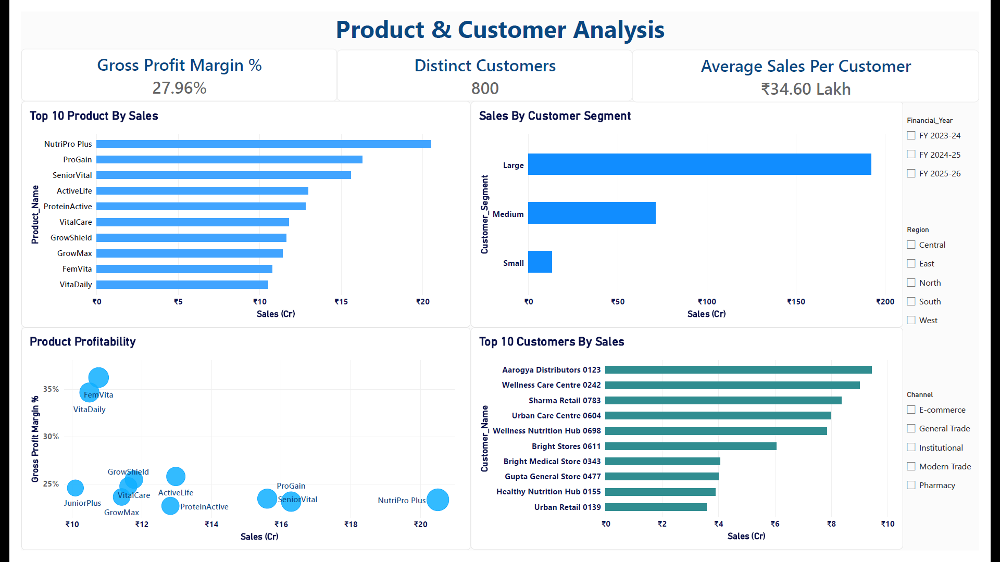

# NourishCo FMCG — Sales, Profitability & Business Performance Analytics

### Excel | Power BI | DAX | Data Modeling | Business Intelligence

## Project Overview

NourishCo is a fictional FMCG nutrition and healthcare company. This project analyzes a realistic synthetic dataset covering three financial years (April 2023 – March 2026).

The objective is to evaluate sales performance, profitability, regional and channel performance, customer contribution, and sales target achievement through Excel-based analysis and interactive Power BI dashboards.

The project demonstrates practical business intelligence and analytical skills, supported by FMCG domain knowledge.

## Business Objectives

- Monitor overall sales, profitability, and gross margin performance.
- Compare sales and profitability across regions and distribution channels.
- Identify high-performing and underperforming products.
- Analyze customer segments and revenue concentration.
- Evaluate actual sales against simulated sales targets.
- Develop interactive dashboards to support business performance reviews.

## Dataset Overview

| Metric | Details |
|---|---|
| Dataset type | Synthetic FMCG transactional data |
| Analysis period | April 2023 – March 2026 |
| Total transactions | 75,001 |
| Unique customers | 800 |
| Unique products | 30 |
| Territories | 36 |
| Regions | North, South, East, West, Central |
| Distribution channels | General Trade, Modern Trade, E-commerce, Pharmacy, Institutional |
| Tools | Microsoft Excel, Power BI, DAX |

**Note:** All data is synthetic and created for portfolio and educational purposes. It does not represent actual Nestlé or any other company's business performance.
## Key Performance Indicators (KPIs)

The following KPIs were calculated using Excel and DAX measures in Power BI to evaluate overall business performance.

| KPI | Value |
|---|---|
| Total Sales | ₹276.82 Cr |
| Total Profit | ₹77.40 Cr |
| Gross Profit Margin | 27.96% |
| Total Quantity Sold | 55.37 Lakh units |
| Total Sales Target | ₹602.64 Cr |
| Target Achievement | 45.93% |
| Unique Customers | 800 |
| Unique Products | 30 |
| Total Transactions | 75,001 |

### KPI Definitions

- **Total Sales:** Net sales revenue after applicable discounts.
- **Total Profit:** Total Sales minus Total Cost.
- **Gross Profit Margin (%):** Total Profit divided by Total Sales × 100.
- **Target Achievement (%):** Actual Sales divided by Sales Target × 100.
- **Average Sales per Customer:** Total Sales divided by the number of unique customers.

*Note: The sales targets are simulated for this portfolio project and should not be interpreted as actual company targets.*

## Power BI Dashboard

The Power BI report contains two interactive pages designed to evaluate FMCG business performance.

### 1. Executive Overview

Provides a consolidated view of sales, profitability, sales trends, regional performance, channel contribution, and target achievement.


### 2. Product & Customer Analysis

Analyzes product sales and gross margins, customer segments, top customers, and product profitability.



The dashboards support interactive filtering by financial year, region, and distribution channel.

## Key Business Insights & Recommendations

### 1. Regional Sales & Profitability
**Findings:**
- North generated the highest sales at ₹64.58 Cr.
- West recorded the highest regional gross margin at 29.12%.
- Central had the lowest sales (₹42.81 Cr) and gross margin (26.88%).

**Recommendations:**
- Investigate Central's product mix, pricing, distribution coverage, and customer performance.
- Study West's higher-margin product and channel mix to identify practices that could be applied elsewhere.

### 2. Distribution Channel Performance
**Findings:**
- General Trade generated the highest sales at ₹70.96 Cr, with a 30.28% gross margin.
- Pharmacy achieved the highest gross margin at 30.71%.
- Institutional recorded the lowest gross margin at 23.26%.

**Recommendations:**
- Review institutional pricing, discounts, and product mix to identify margin improvement opportunities.
- Evaluate opportunities to grow profitable General Trade and Pharmacy sales while considering channel costs and demand.

### 3. Product Profitability
**Findings:**
- NutriPro Plus generated the highest product sales at ₹20.50 Cr but recorded a relatively low gross margin of 23.33%.
- FemVita generated ₹10.77 Cr in sales with a higher gross margin of 36.23%.

**Recommendations:**
- Investigate NutriPro Plus's pricing, discounts, and product costs.
- Evaluate whether FemVita has opportunities for profitable growth without assuming that higher margins guarantee higher demand.

### 4. Customer Segment Performance
**Findings:**
- Large customers contributed approximately 69.46% of total sales.
- Medium customers contributed 25.75%, while Small customers contributed 4.79%.
- The top 10 customers accounted for approximately 23.20% of total sales.

**Recommendations:**
- Monitor revenue concentration and retention among major customers.
- Assess the growth potential of medium and small customers based on profitability, purchase frequency, and service costs.

### 5. Sales Target Achievement
**Findings:**
- Total sales reached ₹276.82 Cr against simulated targets of ₹602.64 Cr.
- Overall target achievement was 45.93%.
- The gap between actual sales and simulated targets was approximately ₹325.82 Cr.

**Recommendations:**
- Review target-setting assumptions and compare achievement across regions, channels, and financial years.
- Investigate performance gaps before proposing corrective actions, since the targets are synthetic.

## Business Conclusion

The analysis identifies opportunities to investigate regional performance differences, channel profitability, product margins, customer concentration, and sales target achievement.

The project demonstrates how Excel-based data analysis and Power BI dashboards can support structured FMCG performance reviews and data-informed business decisions.

*All findings are based on synthetic data. Recommendations are analytical hypotheses requiring further business validation.*

## Tools & Technologies

| Tool | Application |
|---|---|
| Microsoft Excel | Data preparation, validation, formulas, PivotTables, and business performance analysis |
| Power BI | Data modeling, interactive dashboards, and business performance reporting |
| DAX | KPI measures, sales and profitability calculations, target achievement, and customer metrics |

## Project Methodology

1. **Data Preparation:** Organized and validated synthetic FMCG transactional data in Excel.
2. **Exploratory Analysis:** Used Excel formulas and PivotTables to analyze sales, profitability, customers, products, regions, and channels.
3. **Data Modeling:** Imported the data into Power BI, established table relationships, and created a date dimension.
4. **DAX Calculations:** Developed measures for sales, profit, gross margin, quantity, customers, and target achievement.
5. **Dashboard Development:** Built two interactive report pages with KPI cards, trend charts, performance comparisons, and slicers.
6. **Business Interpretation:** Identified performance gaps and developed practical recommendations based on the findings.

## Repository Structure

```text
NourishCo-FMCG-Sales-Analytics/
│
├── Data/
│   └── NourishCo_FMCG_Raw_Data.xlsx
│
├── PowerBI/
│   └── NourishCo_Dashboard.pbix
│
├── Screenshots/
│   ├── Executive_Overview.png
│   └── Product_Customer_Analysis.png
│
└── README.md
```

## How to Explore the Project

1. Review the dashboard screenshots in the Screenshots folder or above in this README.
2. Download the Excel workbook from the Data folder to explore the synthetic dataset and analysis.
3. Download the `.pbix` file from the PowerBI folder.
4. Open the `.pbix` file using Microsoft Power BI Desktop to explore the interactive report and DAX measures.

## Project Disclaimer

This is an independent portfolio project using synthetic FMCG data. It is not affiliated with Nestlé or any other real company, and no confidential company data was used.
  
  
  
