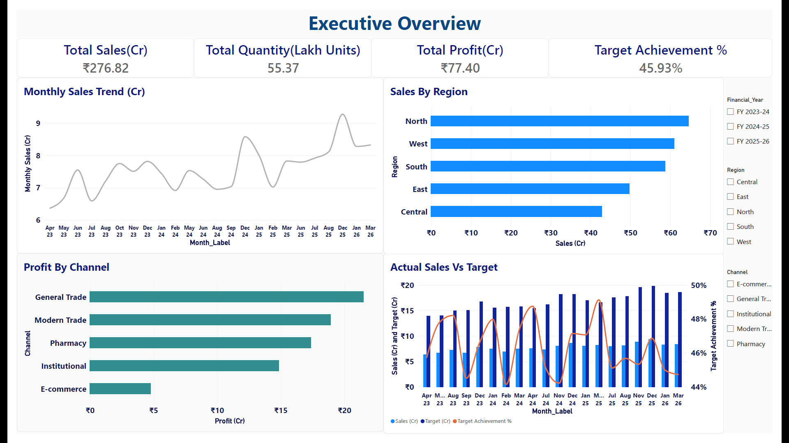

# NourishCo FMCG — Sales, Profitability & Business Performance Analytics

### Excel | Power BI | DAX | Data Modeling | Business Intelligence

## Project Overview

NourishCo is a fictional FMCG nutrition and healthcare company. This project analyzes a realistic synthetic dataset covering three financial years (April 2023 – March 2026).

The objective is to evaluate sales performance, profitability, regional and channel performance, customer contribution, and sales target achievement through Excel-based analysis and interactive Power BI dashboards.

The project demonstrates practical business intelligence and analytical skills, supported by FMCG domain knowledge.

## Business Objectives

- Monitor overall sales, profitability, and gross margin performance.
- Compare sales and profitability across regions and distribution channels.
- Identify high-performing and underperforming products.
- Analyze customer segments and revenue concentration.
- Evaluate actual sales against simulated sales targets.
- Develop interactive dashboards to support business performance reviews.

## Dataset Overview

| Metric | Details |
|---|---|
| Dataset type | Synthetic FMCG transactional data |
| Analysis period | April 2023 – March 2026 |
| Total transactions | 75,001 |
| Unique customers | 800 |
| Unique products | 30 |
| Territories | 36 |
| Regions | North, South, East, West, Central |
| Distribution channels | General Trade, Modern Trade, E-commerce, Pharmacy, Institutional |
| Tools | Microsoft Excel, Power BI, DAX |

**Note:** All data is synthetic and created for portfolio and educational purposes. It does not represent actual Nestlé or any other company's business performance.
## Key Performance Indicators (KPIs)

The following KPIs were calculated using Excel and DAX measures in Power BI to evaluate overall business performance.

| KPI | Value |
|---|---|
| Total Sales | ₹276.82 Cr |
| Total Profit | ₹77.40 Cr |
| Gross Profit Margin | 27.96% |
| Total Quantity Sold | 55.37 Lakh units |
| Total Sales Target | ₹602.64 Cr |
| Target Achievement | 45.93% |
| Unique Customers | 800 |
| Unique Products | 30 |
| Total Transactions | 75,001 |

### KPI Definitions

- **Total Sales:** Net sales revenue after applicable discounts.
- **Total Profit:** Total Sales minus Total Cost.
- **Gross Profit Margin (%):** Total Profit divided by Total Sales × 100.
- **Target Achievement (%):** Actual Sales divided by Sales Target × 100.
- **Average Sales per Customer:** Total Sales divided by the number of unique customers.

*Note: The sales targets are simulated for this portfolio project and should not be interpreted as actual company targets.*

## Power BI Dashboard

The Power BI report contains two interactive pages designed to evaluate FMCG business performance.

### 1. Executive Overview

Provides a consolidated view of sales, profitability, sales trends, regional performance, channel contribution, and target achievement.

### 2. Product & Customer Analysis

Analyzes product sales and gross margins, customer segments, top customers, and product profitability.

The dashboards support interactive filtering by financial year, region, and distribution channel.
  
